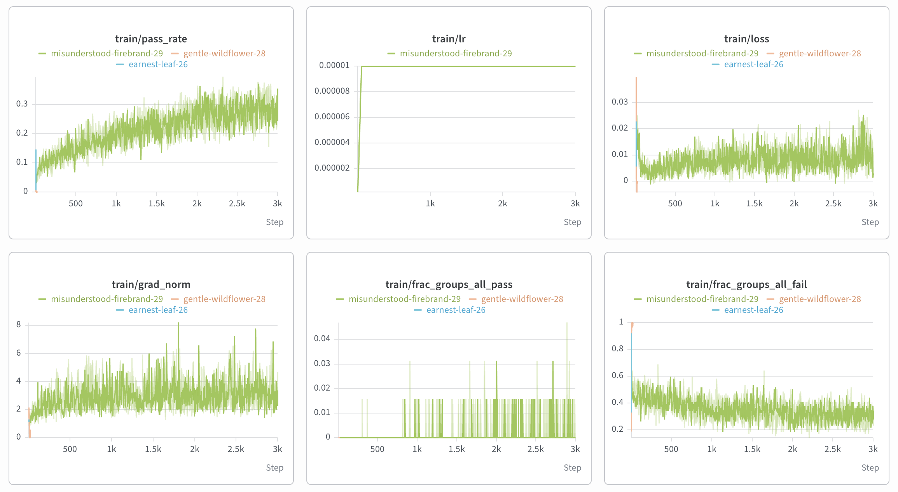

# MaxRL on 17x17 Mazes

A small reproduction of **MaxRL** ([arXiv 2602.02710](https://arxiv.org/abs/2602.02710)) on maze path-finding.
A ~2.9M-parameter Qwen-style transformer is first trained with supervised fine-tuning to emit
a path through a 17x17 maze, then fine-tuned with MaxRL using a binary "reached the goal" reward.

## Pipeline

```
train.py (SFT, 1500 steps)  ->  train_grpo.py (MaxRL, 3000 steps)  ->  eval.py (val.json)
checkpoints/nanoqwen_1500.pt    checkpoints/maxrl/step_*.pt            eval_results/<ckpt>.jsonl
```

## Data

`data/train.json` (999,600 mazes) and `data/val.json` (400 mazes). Each entry is
`{"sequence": ..., "optimal_path_length": ...}`, where a sequence looks like:

```
GRID_START WALL WALL ... START PATH ... GOAL ... NEWLINE ... GRID_END PATH_START DOWN DOWN RIGHT ... DONE <eos>
```

Tokens come from a word-level tokenizer over a 19-token vocabulary (`MAZE_VOCAB` in `dataset.py`).
The prompt is everything up to and including `PATH_START`; the completion is the move list ending in `DONE`.
`data/` and `checkpoints/` are gitignored.

## Model

`NanoQwen` (`model.py`):

| | |
|---|---|
| Parameters | ~2.9M |
| Layers / hidden / MLP | 4 / 256 / 1024 (SiLU) |
| Attention | 4 heads, GQA with 2 KV groups, QK-RMSNorm |
| Positions | RoPE, θ = 1e6 |
| Embeddings | tied input/output |
| Max sequence length | 512 |

## MaxRL vs GRPO

The only algorithmic difference from GRPO is the advantage normalisation. For the G rollouts of one prompt,
with mean reward r̂:

```
GRPO :  A_i = (r_i - r̂) / (std + eps)
MaxRL:  A_i = (r_i - r̂) / (r̂ + eps)
```

- **Reward** is binary: 1 if the parsed moves reach the goal, else 0. Format errors and wall hits get 0.
  The judge in `rewards.py` follows the official MaxRL maze judge.
- **No KL penalty, one on-policy gradient step per rollout batch** (`ppo_epochs = 1`), so the clipped
  surrogate reduces to REINFORCE with MaxRL advantages.
- Groups where every rollout fails have A = 0 and contribute no gradient.

## Usage

```bash
# 1. SFT: 1500 steps, batch 128, Adam lr 1e-4, loss only on tokens after PATH_START
python train.py

# 2. MaxRL: G=32 rollouts x 64 prompts per step, 3000 steps, AdamW lr 1e-5 (50 warmup), grad clip 1.0
#    logs to W&B project "maze-maxrl", saves checkpoints/maxrl/step_*.pt every 250 steps
python train_grpo.py

# 3. Evaluate the RL policy on data/val.json
python eval.py                                        # default: checkpoints/maxrl/step_3000.pt, greedy
python eval.py --ckpt checkpoints/maxrl/step_1500.pt  # a different RL step
```

`eval.py` flags: `--ckpt`, `--temperature` (0 = greedy), `--batch_size` (128), `--max_new_tokens` (64).
Hyperparameters live in `config.py` (`NanoQwenConfig`, `RLHFConfig`).

## Training curves




- `train/pass_rate` (fraction of the 64 × 32 rollouts that solve their maze) rises from ~0.1 to ~0.3 over 3000 steps.
- `train/frac_groups_all_fail` falls from ~0.45 to ~0.3, so more prompts produce a useful gradient.
- `train/frac_groups_all_pass` stays near 0: almost no maze is solved by all 32 samples.
- `train/lr` warms up to 1e-5 over 50 steps and stays constant.

## Results

Greedy decoding with `checkpoints/maxrl/step_3000.pt` on the 400 validation mazes:

| Metric | Count | Rate |
|---|---|---|
| Exact match with label | 153 / 400 | 38.25% |
| Solved (reaches goal) | 153 / 400 | 38.25% |
| Optimal (solved in `optimal_path_length` steps) | 153 / 400 | 38.25% |
| Format errors | 0 / 400 | 0% |

**Training was cut short.** The RL run stopped at 3,000 steps, and `train/pass_rate` was still rising
when it ended (see the curves above). The paper trains for about 9,000 steps, so a longer run would likely
improve these numbers.

Every solved maze matched the labelled path exactly, and every failure was a path that hit a wall or
stopped short; the model never produced an alternative correct route. Per-maze records
(`{idx, label, generated, flags}`) are in `eval_results/step_3000.jsonl`.

## Files

| File | Purpose |
|---|---|
| `config.py` | `NanoQwenConfig` (model + SFT) and `RLHFConfig` (MaxRL) |
| `dataset.py` | tokenizer, `MazeDataset` (SFT), `MazeDataset_RL` (prompts) |
| `model.py` | `NanoQwen` transformer |
| `rewards.py` | `MazeEnv` simulator, `parse_moves`, binary `reward_fn` |
| `train.py` | SFT trainer |
| `train_grpo.py` | MaxRL trainer with pass@k eval |
| `eval.py` | greedy generation on val.json, per-maze comparison to labels |
